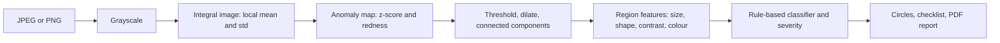

# InspectIQ

**Photograph a surface. Get a numbered list of defects, a checklist and a finished PDF report.**

   

**Live demo: https://inspectiq-ivaz.onrender.com** 

(free tier, the first load can take about 30 seconds to wake)

Technicians who inspect plates, welds, panels and pipes still write reports by hand. InspectIQ takes one photo, finds cracks, scratches, corrosion and pits, circles and numbers each one, rates how serious it looks, fills in a checklist and writes the PDF. It was shaped by the author's inspection-image work at Konecranes.


<table>
<tr><td></td><td></td></tr>
<tr><td align="center">Home</td><td align="center">Built-in accuracy benchmark</td></tr>
</table>

## The problem

Manual inspection reporting is slow and inconsistent: photos in one place, notes in another, a checklist filled from memory, and a report typed up later. Two inspectors describe the same crack differently. InspectIQ gives every photo the same treatment, the same numbered findings and the same report layout, while keeping the inspector in charge of the final call.

## Try it in 30 seconds

1. Open the [live demo](https://inspectiq-ivaz.onrender.com) and choose **Try a test panel**.
2. Watch the circles draw around each numbered finding.
3. Move the **sensitivity** slider and see the detector re-run on the server.
4. Toggle **Show true defect positions** to compare the circles with where the generator actually drew defects.
5. Download the **PDF report**, then open **Accuracy** and run the benchmark yourself.

## Measured results

**Benchmark on synthetic panels.** 40 generated panels with 85 known defects. A detection counts when it overlaps a true defect with IoU of at least 0.2. At the default 70% sensitivity:

| Precision | Recall | F1 | Found | False alarms | Missed |
|---|---|---|---|---|---|
| 1.00 | 0.95 | **0.98** | 81 | 0 | 4 |

These panels and the detector were written by the same person, so real photos will score lower. The `/accuracy` page lets anyone re-run the test and see precision and recall at every sensitivity setting, so the trade-off between false alarms and misses is visible.

**On a real uploaded photo** at 55% sensitivity, the exported report listed 11 findings (1 crack, 9 pits, 1 scratch). Ten were rated low, and the crack was rated medium with 86% confidence. Every finding needs confirmation by a qualified person on site, and the report says so.

## What it does

- **Detects** cracks, scratches, corrosion, pits, surface wear and likely glare.
- **Numbers and circles** every finding with a hand-drawn ring, and links each ring to its card.
- **Rates severity** (low, medium, high) from size and contrast, with a confidence figure and a suggested follow-up for each type.
- **Checklist** for structural integrity, corrosion, surface wear and pitting, and surface finish, with "nothing detected" clearly not a pass.
- **Sensitivity slider** that re-analyses on the server and updates the circles.
- **Anomaly heat map** that shows where the detector sees trouble.
- **PDF report** with the marked-up photo, findings, checklist, notes and method.
- **History** of your inspections with thumbnails, and editable asset name, inspector and notes.
- **Built-in benchmark** with a synthetic panel generator and ground truth.

## How it works

The whole pipeline is written from scratch in JavaScript (`jpeg-js`, `pngjs`), with no model weights and no training data.



1. **Integral image.** Gives the mean and standard deviation of any pixel's neighbourhood in constant time, so local contrast is cheap to compute.
2. **Z-score.** A pixel that is many standard deviations from its surroundings is an anomaly. A redness measure helps with rust.
3. **Threshold, dilate, label.** A 3x3 dilation joins fragments, then connected components give candidate regions.
4. **Region moments.** Size, elongation, orientation, contrast and colour describe each region.
5. **Rules.** Long and thin is a crack or scratch, red and patchy is corrosion, small and round is a pit, and so on. Severity and confidence come from size and contrast.
6. **Report.** A checklist and a plain-language summary are generated from the findings.

Uploads are limited to 8 MB, resized to at most 800 px and re-encoded as PNG, which drops metadata.

## API

| Method | Path | Purpose |
|---|---|---|
| GET | `/healthz` | Health check |
| POST | `/api/inspections` | Upload a photo and analyse it |
| POST | `/api/inspections/sample` | Create a synthetic test panel |
| GET | `/api/inspections` | List your inspections |
| GET | `/api/inspections/:id` | One inspection with findings and checklist |
| PATCH | `/api/inspections/:id` | Change sensitivity, asset, inspector or notes |
| DELETE | `/api/inspections/:id` | Delete an inspection and its photo |
| GET | `/api/inspections/:id/image.png` | The stored photo |
| GET | `/api/inspections/:id/annotated.png` | Photo with numbered boxes |
| GET | `/api/inspections/:id/heatmap.png` | Anomaly heat map |
| GET | `/api/inspections/:id/report.pdf` | PDF report |
| GET | `/api/preview.png` | Synthetic preview used on the home page |
| POST | `/api/benchmark` | Run the accuracy benchmark |

## Project structure

```
server/
  detect.js    the detection pipeline, thresholds, checklist and summary
  synth.js     synthetic panel generator with ground truth
  bench.js     IoU matching, precision, recall and F1 sweep
  imaging.js   decode, resize, annotate, heat map, PNG encode
  report.js    PDF report (pdfkit)
  db.js        SQLite storage, image files and auto-purge
  index.js     Express routes, uploads, limits, security headers
web/           React 18 + Vite front end (hand-drawn UI with rough.js)
test/          7 automated tests
```

## Design decisions

- **Classical vision first.** It is explainable, needs no training data, and gives a baseline that a learned model must beat.
- **Ground truth in the app.** A detector with no way to be scored is a claim. The benchmark makes it a measurement.
- **Honest labelling.** Synthetic results are labelled synthetic. Reports say pixel sizes are not millimetres.
- **Human in the loop.** The tool suggests and the inspector confirms. "Nothing detected" is never shown as a pass.

## Run it locally

Needs Node 22.13 or newer (uses the built-in `node:sqlite`).

```bash
npm install
npm run dev                  # API on :3000, Vite dev server on :5173
npm test                     # 7 automated tests
npm run build && npm start   # production build, everything on :3000
```

## Privacy by design

No accounts and no cookies. Each browser gets a random ID in localStorage, sent as a header, and every inspection is scoped to it. Photos and records are deleted automatically after 30 days. Uploaded images are re-encoded, which strips metadata. Requests are rate limited and a strict Content-Security-Policy is set. The app has its own privacy and terms pages.

## Honest limits

- No depth or millimetre measurement. Severity comes from pixel size and contrast.
- It uses rules, not a trained model. Dirt, shadows and glare can look like defects, and faint damage can be missed.
- "Nothing detected" is not a pass.
- Benchmark panels and detector share an author, so field accuracy will be lower.
- It is a portfolio project, not a certified inspection tool. A qualified person must confirm every finding.

## Roadmap

- Collect real labelled photos and compare this baseline with a learned model.
- Scale calibration from a reference object in the frame, to report millimetres.
- Compare two inspections of the same asset to estimate growth.

---

## Stack

Node 22, Express 4, `node:sqlite`, `jpeg-js`, `pngjs`, `multer`, pdfkit, React 18, Vite, rough.js, Motion, Lenis. About 1,700 lines of application code.

---

## 👩‍💻 Author

**Subhalaxmi Panda**  
Software Developer | AI/ML Enthusiast | Full-Stack Developer

I enjoy building practical software solutions, exploring emerging technologies, and turning ideas into scalable, user-focused applications.

### Connect with Me

<p align="left">
  <a href="https://github.com/SubhuPanda21">
    
  </a>
  <a href="https://www.linkedin.com/in/subhalaxmipanda">
    
  </a>
</p>

---

<p align="center">
  <b>Designed & Developed by Subhalaxmi Panda</b>
  <br>
  Building. Learning. Innovating.
</p>

