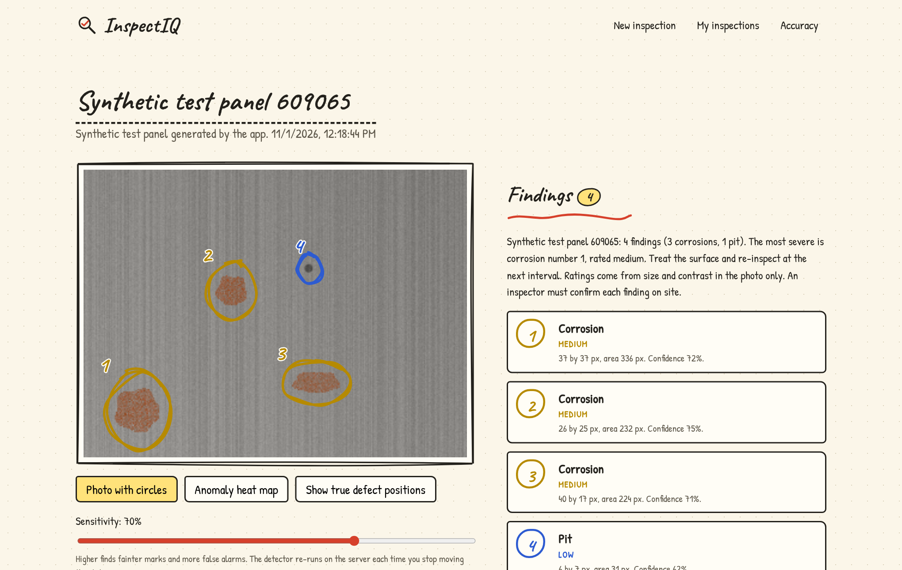
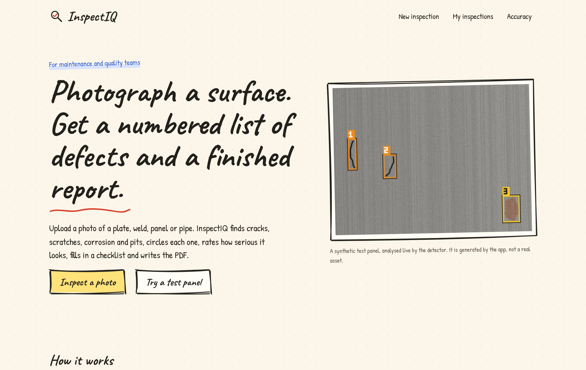
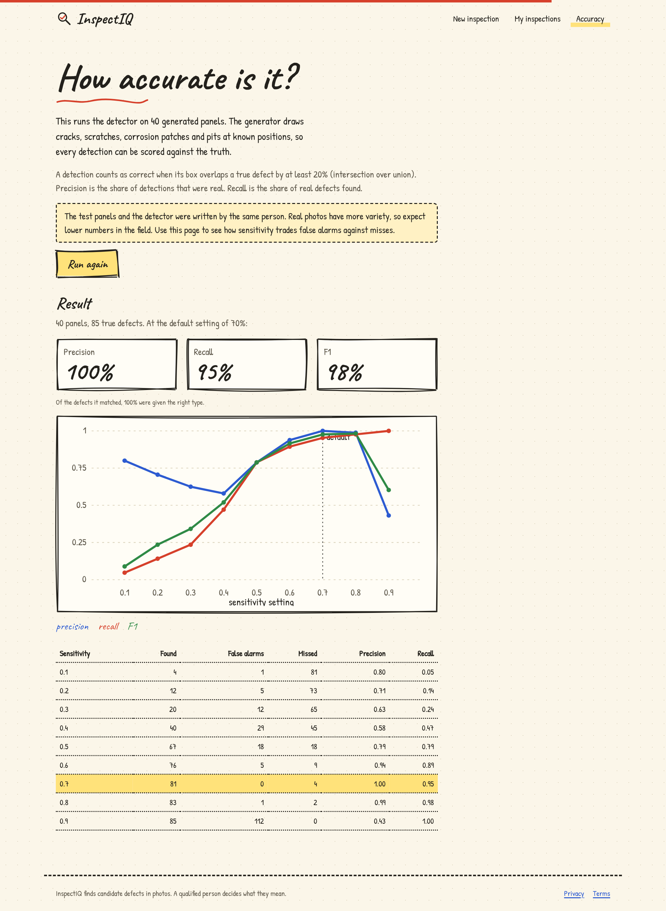
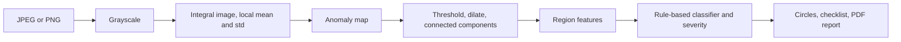

# InspectIQ

**Photograph a surface. Get a numbered list of defects, a checklist and a finished PDF report.**

   

Technicians who inspect plates, welds, panels and pipes still write reports by hand. InspectIQ takes one photo, finds cracks, scratches, corrosion and pits, circles and numbers each one, rates how serious it looks, fills in a checklist and writes the PDF. It was shaped by the author's inspection-image work at Konecranes.



<table>
<tr><td></td><td></td></tr>
<tr><td align="center">Home</td><td align="center">Built-in accuracy benchmark</td></tr>
</table>

## Measured results

**Benchmark on synthetic panels** (40 generated panels, 85 known defects, a detection counts when it overlaps a true defect with IoU of at least 0.2), at the default 70% sensitivity:

| Precision | Recall | F1 | Found | False alarms | Missed |
|---|---|---|---|---|---|
| 1.00 | 0.95 | **0.98** | 81 | 0 | 4 |

These panels and the detector were written by the same person, so real photos will score lower. The `/accuracy` page lets anyone re-run the test and see precision and recall at every sensitivity setting, so the trade-off between false alarms and misses is visible.

**On a real uploaded photo** at 55% sensitivity, the exported report listed 11 findings (1 crack, 9 pits, 1 scratch), 10 of them rated low and the crack rated medium with 86% confidence. Every finding needs confirmation by a qualified person on site, and the report says so.

## How it works

The whole pipeline is written from scratch in JavaScript (`jpeg-js`, `pngjs`), with no model weights and no training data.

1. Grayscale, then an **integral image** gives the local mean and standard deviation of every pixel's neighbourhood in constant time.
2. A pixel's **z-score** against its surroundings, plus a redness measure for rust, gives an anomaly map.
3. Threshold, dilate, then **connected components** give candidate regions.
4. **Region moments** (size, elongation, orientation, contrast, colour) feed a rule-based classifier: crack, scratch, corrosion, pit, surface wear, glare.
5. Severity and confidence come from size and contrast. A checklist and a written summary are generated from the findings.
6. Moving the **sensitivity slider** re-runs the detector on the server and the circles redraw.

Uploads are limited to 8 MB, resized to at most 800 px and re-encoded as PNG, which drops metadata.



## Honest limits

No depth or millimetre measurement: severity comes from pixel size and contrast. It uses rules, not a trained model, so dirt, shadows and glare can look like defects and faint damage can be missed. "Nothing detected" is not a pass. A natural next step is to collect real labelled photos and compare this baseline with a learned model.

## Stack

Node 22, Express 4, `node:sqlite`, `jpeg-js`, `pngjs`, `multer`, pdfkit, React 18, Vite, rough.js, Motion, Lenis. About 1,700 lines of application code.

## Run it

Needs Node 22.13 or newer (uses the built-in `node:sqlite`).

```bash
npm install
npm run dev                  # API on :3000, Vite dev server on :5173
npm test                     # 7 automated tests
npm run build && npm start   # production build, everything on :3000
```

## Deploy

Works on any host that runs a Node service or a Dockerfile (Render, Railway, Fly.io, a VPS).

| Setting | Value |
|---|---|
| Build / start | `npm install && npm run build` / `npm start`, or use the included `Dockerfile` |
| `DATA_DIR` | A folder on a **persistent disk** (the Dockerfile uses `/data`). Without one, data resets on each deploy |
| `TRUST_PROXY` | `1` behind a platform proxy, so rate limits see real client IPs |
| `PORT` | Set by most hosts automatically |

Put your contact email in `web/src/site.config.js` so the privacy and terms pages show it.

## Privacy by design

No accounts and no cookies. Each browser gets a random ID in localStorage, sent as a header, and every row is scoped to it. Data is deleted automatically after 30 days. Requests are rate limited and a strict Content-Security-Policy is set. The app has its own privacy and terms pages.
